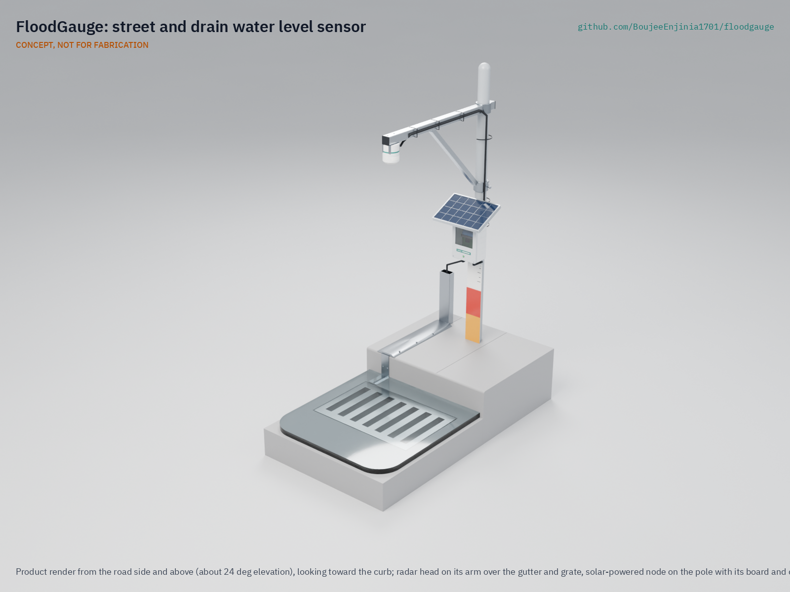
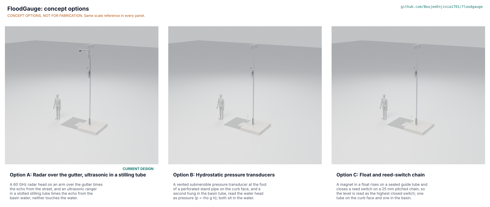
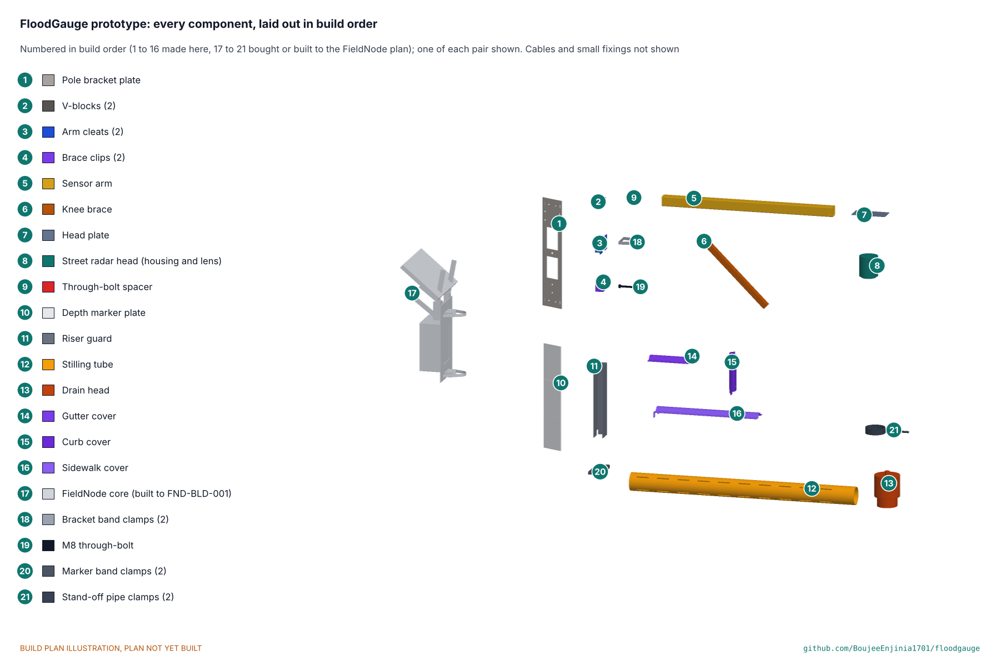

# FloodGauge

      

**Area:** Smart Cities · **TRL:** 3 of 9 (proof of concept on paper) · **Value-engineering target:** USD 160 for FloodGauge-specific parts; estimated cost of the constructable design USD 205.50 (FieldNode costed separately) · **Difficulty:** 2 of 5

A street and drain water level sensor using ultrasonic or radar ranging that publishes levels to a city's alert service, so crews and residents can be warned when drains back up or streets begin to flood.

[Exploded render](media/render-exploded.png) · [Studio render](media/render-studio.png) · [Interactive 3D model](media/viewer.html) · [Concept blueprint (PDF)](media/concept-blueprint.pdf) · [General arrangement (PDF)](cad/drawings/FLG-DWG-001.pdf) · [STEM check](docs/01b-stem-check.md) · [Concept options](docs/02a-concept-options.md) · [Calculations](docs/04-calcs/01-sizing.md) · [Prototype build plan](docs/05-build-plan.md) · [Requirements](docs/03-requirements.md) · [Traceability](docs/03b-traceability.md) · [Risk register](docs/09-risk.md) · [Design decisions](docs/06-design-decisions.md) · [Review note](docs/REVIEW.md)

## Concept rationale

Street-level readings give minutes of warning where river gauges give none. Streets flood in two ways: the drain fills and backs up through the grate, or the grate is blocked and water ponds above an empty drain. FloodGauge watches both from one pole. A radar head on a short arm over the gutter measures water depth on the street, and an ultrasonic head in a stilling tube inside the catch basin sees the drain filling first. The lab's FieldNode core supplies the enclosure, solar power and LoRaWAN radio, so this project adds only the heads, the mounting and the alert logic.

Keeping it open and garage-buildable lets a city, a university or a neighborhood group build, inspect and repair its own gauges and own its data. The parts are off the shelf or cut with hand tools, the designs are under CERN-OHL-S-2.0 and the software under MIT, and the gauge sends water levels only: no camera, no microphone.

## Burning platform

About 1.81 billion people, 23 % of the world's population, are directly exposed to 1-in-100-year floods, and 89 % of them live in low- and middle-income countries ([Rentschler, Salhab and Jafino, 2022](https://www.nature.com/articles/s41467-022-30727-4)). Only 108 countries, 55 % of the total, reported multi-hazard early warning systems in 2024, and countries with limited coverage had disaster mortality nearly six times higher than those with substantial coverage ([UNDRR and WMO, 2024](https://www.undrr.org/reports/global-status-MHEWS-2024)).

Depths that look harmless kill. The US National Weather Service warns that 150 mm (6 in) of fast-moving water can knock over an adult and 300 mm (12 in) can carry away most cars, and that over half of flood drownings happen when a vehicle is driven into flood water ([NWS](https://www.weather.gov/safety/flood-turn-around-dont-drown)). Those depths build up on a street in minutes, well before a river gauge downstream responds.

## Where it could be used

### By industry

| Industry | Use |
| --- | --- |
| Municipal drainage and public works | Find blocked or surcharging inlets during a storm and send crews to the right street |
| Emergency management | Street depth and rate of rise to close underpasses and warn basement residents |
| Road and transit operators | Flooding alerts at underpasses, bus stops and depot entrances |
| Property and campus management | Early warning for car parks, loading docks and basement entrances |
| Insurance and resilience planning | An open record of where and how often streets flood |
| Research and education | Open, repeatable urban hydrology data for universities and schools |

### By country or region

| Country or region | Why it matters there |
| --- | --- |
| United States | Over half of flood drownings involve vehicles driven into water ([NWS](https://www.weather.gov/safety/flood-turn-around-dont-drown)); New York City's FloodNet reached 250 street sensors in 2024 ([FloodNet](https://www.floodnet.nyc/about)), showing demand for street-level data. |
| Netherlands | The highest share of population in flood zones worldwide, 58.7 % ([Rentschler et al., 2022](https://www.nature.com/articles/s41467-022-30727-4)); dense cities need drain-level data as well as dikes. |
| Germany and Belgium | The July 2021 floods caused more than 200 deaths after record rainfall ([Copernicus, 2021](https://climate.copernicus.eu/esotc/2021/flooding-july)). |
| India and China | Together about 785 million flood-exposed people, over one third of the global total ([Rentschler et al., 2022](https://www.nature.com/articles/s41467-022-30727-4)), many in fast-growing cities. |
| Vietnam | 46 % of the population lives in flood zones, the highest share among developing countries ([Rentschler et al., 2022](https://www.nature.com/articles/s41467-022-30727-4)). |
| Sub-Saharan Africa | 44 % of the 170 million people facing both high flood risk and extreme poverty live here ([Rentschler et al., 2022](https://www.nature.com/articles/s41467-022-30727-4)); low-cost open gauges suit city budgets. |

## What sparked the idea

The idea traces back to the night of September 1, 2021, when the remnants of Hurricane Ida hit New York City. The city's sewers are designed to carry 44 mm (1.75 in) of rain an hour, and Ida brought more than two hours above that rate ([NYC Comptroller, 2024](https://comptroller.nyc.gov/reports/is-new-york-city-ready-for-rain/)). Drains backed up into streets and basements. Of the 14 injury deaths in the city, 10 were drownings in basement apartments, and the deaths for which a time is known came before the state of emergency was declared, and that declaration carried no basement-specific advice ([Yuan et al., 2024](https://www.cambridge.org/core/journals/disaster-medicine-and-public-health-preparedness/article/immediate-injury-deaths-related-to-the-remnants-from-hurricane-ida-in-new-york-city-september-12-2021/69BD8C527FD016A2CAC703C7023B2251)). The warning that mattered on that street was the drain filling and the water rising at the curb, and that is what FloodGauge measures.

## Problem

Urban flash floods rise in minutes, and warnings rely on river gauges far from the streets that flood.

## Concept

A street and drain water level sensor using ultrasonic or radar ranging that publishes levels to a city's alert service, so crews and residents can be warned when drains back up or streets begin to flood.

Full design precis: [docs/02-concept.md](docs/02-concept.md)

## STEM check

Thirty-two claims across the three concept options are checked (FLG-STM-001, `docs/04-calcs/stem_check.py`): fifteen are within known science and seventeen are plausible and wait for the radar and ranger data sheets, the weighed mass, a module immersion rating, a transducer class or the TRL 4 tests, so the check stays open; none fails outright. One detail failed on the first pass and was fixed under Amish's standing instruction: option C's solid ring floats sank, so they became sealed hollow shells filled with foam (FLG-DDR-004 F1). An independent review also showed the through-bolt's twist factor of 37 was wrong (it is 1.8, with a stronger class of bolt, FLG-DDR-004 F2), which makes the mass on the pole and the twist on small poles the two open structural points.

## Concept options

Option A, radar over the gutter with an ultrasonic ranger in a stilling tube (the current design, score 163 of 220), option B, hydrostatic pressure transducers (174), and option C, a float and reed-switch chain (160), are modelled at the same level of detail (FLG-OPT-001): 171, 112 and 128 parts. B leads A by 6.7 %, inside the 10 % band, so no pick is made and both go to Amish (FLG-DDR-004, "Proposed, awaiting Amish"); C misses the 10 mm accuracy target at its 25 mm switch pitch.

## Key components

- FieldNode core (enclosure, 6 W solar panel, LiFePO4 cell, LoRaWAN radio), shared with other lab projects
- Street head: 60 GHz radar on a short braced arm over the gutter, lens 2.5 to 5.0 m above the road as the site's clearance rule requires (4.6 m in the reference design), on a pole bracket with two V-blocks, two band clamps and an anti-rotation through-bolt
- Drain head: waterproof ultrasonic ranger with wet probe and temperature sensor, in a slotted 75 mm stilling tube inside the catch basin
- Surface cable route for pilots under three bolted steel covers and a riser guard (conduit at permanent sites), depth marker plate with 150 mm and 300 mm bands
- Open alert service on a LoRaWAN gateway such as TwinKit

TRL 3 calculations ([FLG-CAL-001](docs/04-calcs/01-sizing.md)) on the constructable design: alert latency 82 s at the 95th percentile (110 s worst case), street depth error ±6.5 mm with radar, drain level error ±11 mm, under 10 mW of sensor load and 4.99 kg on the pole. Value-engineering target: USD 160. Estimated cost of the constructable design: USD 205.50 for FloodGauge-specific parts (USD 45.50 over the target); USD 344.50 with the USD 139 FieldNode core. No requirement is not met; installation takes 120 min on the pilot surface route, which is the target Amish set for it. See the [design precis](docs/02-concept.md) and [requirements](docs/03-requirements.md). The design choices were decided by Amish on 2026-09-25 ([FLG-DDR-001](docs/decisions/0001-trl2-review-decisions.md), [FLG-DDR-002](docs/decisions/0002-recommendations-accepted.md)); the changes that make the design buildable are in [FLG-DDR-003](docs/decisions/0003-design-for-construction.md), accepted by Amish on 2026-10-02.

The working bill of materials is in [bom/bom.csv](bom/bom.csv).

## Building the prototype

The [prototype build plan](docs/05-build-plan.md) (FLG-BLD-001) shows how to make and fit every component, in order, with a making sketch for each made part, close-ups of the joints and a picture for every assembly step. Sixteen parts are made in a small workshop from aluminium plate, bar, angle and tube, folded galvanized strip and slotted PVC pipe; the rest are bought or built to the FieldNode plan. The design was checked for construction on the model (110 checks), which changed the arm mounting, the brace, the cable covers and the drain head fixing ([FLG-DDR-003](docs/decisions/0003-design-for-construction.md)). Decisions still open are in the [design decisions register](docs/06-design-decisions.md). It is a plan, not yet built.

## Safety

> Install only with traffic and confined space precautions. Street furniture and pole mounts must be installed only with the asset owner's permission, by trained crews, with fall protection and traffic management as local rules require.
>
> Never enter a catch basin: it can hold toxic or oxygen-poor air and fast-rising water. Stormwater carries sewage and chemicals; wear gloves and eye protection. The FieldNode LiFePO4 cell must be fused and charged only between 0 and 45 °C.
>
> An arm over the gutter must clear tall vehicles at the curb; mount it at the height the road authority requires (4.6 m in the reference design), from a mobile elevating platform, and always fit the anti-rotation bolt. Keep the surface cable cover low, beveled and marked so it is not a trip hazard.
>
> FloodGauge supplements official flood warnings and must never be the only warning people rely on.

## Repository layout

| Folder | Contents |
| --- | --- |
| `docs/` | Controlled documents (PRB, STM, OPT, PRC, URS, PRS, RTM, CAL, BLD, DEC, REG, FEA, RSK, MKT, PLN, DDR) and `REVIEW.md` |
| `docs/04-calcs/` | `sizing.py` (FLG-CAL-001) and `stem_check.py` (FLG-STM-001) |
| `cad/src/` | build123d Python source, the source of truth for all geometry: `model.py` (options A, B and C, kit 1.9, detail level D3), `options_bc.py`, `flg_parts.py`, `sheets.py`, `build_plan_media.py`, `concept_media.py`, `product_model.py` |
| `cad/step/`, `cad/stl/` | STEP per part and per assembly for every option; STL of the chosen design |
| `cad/drawings/` | FLG-DWG-001 general arrangement and FLG-DWG-101 to 116 making sketches |
| `bom/` | Bill of materials |
| `electronics/` | KiCad schematics and PCB layouts |
| `firmware/` | Microcontroller code |
| `media/` | Renders, perspectives and photos |
| `build-log/` | Dated prototyping notes |

## Documentation

Controlled documents follow the portfolio [documentation standard](.kit/STANDARDS.md). Run `python .kit/render.py --check` to validate them, `python .kit/cad_check.py --export` for the CAD fidelity check and `python docs/04-calcs/sizing.py` for the calculations. Each carries a document ID (FLG-PRC-001 for the precis), a version and a revision history. Branded PDFs are built with `python .kit/render.py` and attached to GitHub Releases when a document is tagged, for example `FLG-PRC-001/v1.0`.

## Credits

Designed by Amish Chadha. See [CONTRIBUTORS.md](CONTRIBUTORS.md) for roles. To cite this design, use [CITATION.cff](CITATION.cff) (GitHub shows it as "Cite this repository").

AI assistance (Claude) was used to accelerate concept renders, prototype documentation and first-pass sizing calculations. Design direction and all decisions are Amish Chadha's, recorded in this repository's decision records (`docs/decisions/`).

## Licenses

- **Hardware** (CAD, drawings, BOM, electronics): [CERN-OHL-S v2](LICENSE)
- **Software** (firmware, scripts, notebooks): [MIT](LICENSE-SOFTWARE)

A project of the [Design Molecule](https://designmolecule.com) lab.
