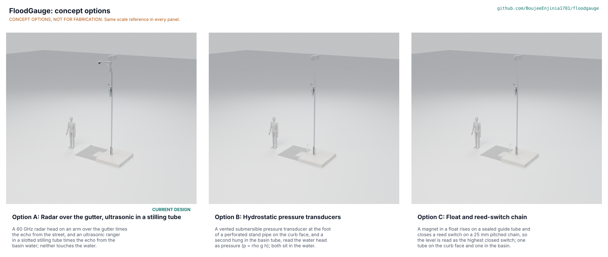

# FloodGauge concept options

Recommendation in one sentence: option B (hydrostatic pressure, 174 points) leads option A (the current design, radar and ultrasonic, 163 points) by 6.7 %, which is inside the 10 % band, so **both A and B go to Amish without a pick** and option C (160) is dropped for missing the accuracy target; **Proposed, awaiting Amish** (FLG-DDR-004). Method: STANDARDS section 21.

## The options

All three share the FieldNode core, the depth marker, the surface cable covers and riser guard, the anchors, the plugs and the stilling tube in the basin, and all three are modelled at detail level D3 in `cad/src/model.py` (`components("A")`, `components("B")`, `components("C")`; B and C in `cad/src/options_bc.py`). Part counts and mass below come from `cad/fidelity.json`; mass is the whole option, including the FieldNode core and the surface covers, not only what hangs on the pole.

### Option A: radar over the gutter, ultrasonic in a stilling tube (current design)

A 60 GHz radar head on a braced arm 4.6 m above the gutter times the echo from the street, and an ultrasonic ranger in a slotted 75 mm stilling tube times the echo from the basin water. Neither touches the water. Street depth error 6.5 mm and basin level error 11.0 mm on paper (FLG-CAL-001 B, C), alert latency 82 s at the 95th percentile. It needs the arm lifted onto the pole, an approval for the arm over the lane, and a radar module whose data sheet is not yet checked. 171 parts (87 made or bought, 84 fasteners), 9.5 kg.

### Option B: hydrostatic pressure transducers

A vented submersible pressure transducer at the foot of a perforated 50 mm stand pipe on the curb face reads the street water, and a second hangs in the basin tube, so the level follows p = rho g h (5.9 kPa at 600 mm). There is no arm, bracket, through-bolt or radar head. Street error about 8.7 mm (STM B2); the water density and the vented reference are the open questions (STM B3). It needs a pipe in the gutter edge within reach of the public, and a transducer class and price to be confirmed. 112 parts (69 made or bought, 43 fasteners), 8.3 kg.

### Option C: float and reed-switch chain

A ring magnet in a hollow float rises on a sealed 16 mm stem and closes a glass reed switch on a chain at 25 mm pitch; the level is the highest closed switch, in the same stand pipe and basin tube as B. The float is a sealed hollow shell because the first solid float sank (FLG-DDR-004 F1). It has the lowest energy and the simplest electronics, but 25 mm steps give plus or minus 12.5 mm, so PR-002 (10 mm) is missed unless the pitch is cut to about 15 mm with more reeds. 130 parts (86 made or bought, 44 fasteners), 8.0 kg.

## First-order numbers

Table 1. Options compared.

| Quantity | Option A | Option B | Option C |
| --- | --- | --- | --- |
| Estimated FloodGauge-specific parts cost (USD) | 205.50 (BOM) | about 191 (estimate) | about 171 (estimate) |
| Mass of the whole option (kg) | 9.5 | 8.3 | 8.0 |
| Street depth error (mm) | 6.5 on paper | about 8.7 | 12.5 (pitch) |
| Basin level error (mm) | 11.0 | about 11 | 12.5 (pitch) |
| Energy per reading | 85 mJ (radar and ultrasonic) | transducer excitation, not budgeted | passive reeds, lowest |
| Parts count | 171 | 112 | 130 |
| STEM check | Within or plausible (S1 to S23) | Within or plausible (B1 to B4) | Within or plausible after fix F1 (C1 to C5) |

The costs of B and C are estimates built from the cost of option A by removing the radar head ($55.00), the arm and bracket ($35.00), the drain head ($24.50) and the cables ($8.00) and adding indicative amounts: two vented transducers at about $40 each and a stand pipe set at about $20 for B; two reed-chain stems with floats at about $60 and a stand pipe set at about $20 for C; both add $8 for vented cables. None is priced from a supplier, so each is "to assess".

## Scoring

Table 2. Weighted scoring (weights: High UR 3, Medium 2, Low 1; scores 1 to 5). The criteria are the 17 user requirements in FLG-URS-001. Scores are the design lead's first-pass judgements, argued in the last column.

| Criterion | Source | Weight | A | B | C | Reason |
| --- | --- | --- | --- | --- | --- | --- |
| Depth range and coverage | UR-001 | 3 | 5 | 5 | 4 | A: radar to 5 m over the gutter, dry to 600 mm. B: pressure covers 0 to 20 kPa. C: float travel 18 to 608 mm in the street pipe. |
| Basin level and blocked-inlet signal | UR-002 | 3 | 4 | 5 | 3 | A: ultrasonic 50 mm above floor to 330 mm below road plus wet probe. B: a hung transducer reads the whole range up to the grate. C: float stops at 340 mm below the road, 25 mm steps. |
| Accuracy | UR-003 | 3 | 4 | 4 | 1 | A: 6.5 mm street, 11.0 mm basin on paper. B: 8.7 mm street (STM B2), basin about 11 mm. C: 25 mm pitch gives plus or minus 12.5 mm, which misses the 10 mm target (STM C3); scored 1 as a High requirement not met. |
| Alert latency | UR-004 | 3 | 4 | 4 | 4 | Same sampling and radio chain in all three (CAL F): 82 s at the 95th percentile. |
| Faster sampling in events | UR-005 | 2 | 4 | 4 | 4 | Same schedule in all three. |
| Works through the storm on stored energy | UR-006 | 3 | 4 | 4 | 5 | A: radar 59 mJ a cycle. B: transducer excitation, not yet budgeted. C: passive reeds read with one analog pin, lowest load. |
| Survives weather and submersion | UR-007 | 3 | 3 | 4 | 3 | A: drain head face IP67 only (PR-009). B: sealed 316L transducers made to be submerged, vent cable at risk (STM B3). C: floats can bind with silt or ice (STM C5). |
| Installed by two people from the surface | UR-008 | 3 | 3 | 4 | 4 | A: lift an arm to 4.6 m, 120 min. B and C: a pipe clamped to the curb face and one tube, no work at height. |
| Fits the pole or curb and clears traffic | UR-009 | 3 | 3 | 4 | 4 | A: mass 4.99 kg of 5.0 and an arm over the lane needing approval. B and C: nothing over the road, but a 50 mm pipe 70 mm into the gutter edge. |
| Safe for the public and crew | UR-010 | 3 | 4 | 3 | 3 | A: nothing within reach but the covers. B and C: a pipe at the curb edge in reach of passers-by and sweepers. |
| No false alarms | UR-011 | 2 | 2 | 4 | 4 | A: a truck or person under the head can read as depth (PR-010 not verifiable). B and C measure water only. |
| Privacy | UR-012 | 3 | 5 | 5 | 5 | No camera or microphone in any option. |
| Radio within network rules | UR-013 | 2 | 3 | 3 | 3 | Same radio in all three. |
| Datum traceable to the road | UR-014 | 2 | 3 | 3 | 4 | All three reference the road surface by survey; B adds a pressure zero to check. |
| Open data | UR-015 | 2 | 5 | 5 | 5 | Same open data path. |
| Cost against the target | UR-016 | 2 | 2 | 3 | 4 | A: USD 205.50 (BOM). B: about USD 191 and C: about USD 171, estimates not priced from a supplier. |
| Resists tampering and theft | UR-017 | 2 | 4 | 2 | 2 | A: arm at 4.6 m, drain head in the basin. B and C: a pipe on the curb face within reach, held by security anchors. |
| **Weighted total (maximum 220)** | | | **163** | **174** | **160** | A 74.1 %, B 79.1 %, C 72.7 % of the maximum |

## Recommendation

B leads A by 6.7 %, within the 10 % band, so no option is picked and both go to Amish. A is the design the repo describes and nothing is redesigned until Amish decides. The case for A is no contact with the water, no object in the road and tamper resistance by height; the case for B is no arm, fewer parts, no air-temperature error and a lower estimated cost. C is dropped unless Amish accepts a 15 mm reed pitch.

Runner-up's best idea to graft: B's hung pressure transducer in the basin tube in place of A's ultrasonic ranger, which removes the temperature correction and the 30 mm blind zone while keeping the radar over the street (FLG-DDR-004, option 3). Recorded as "Proposed, awaiting Amish" in FLG-DEC-001 and argued in FLG-DDR-004.
